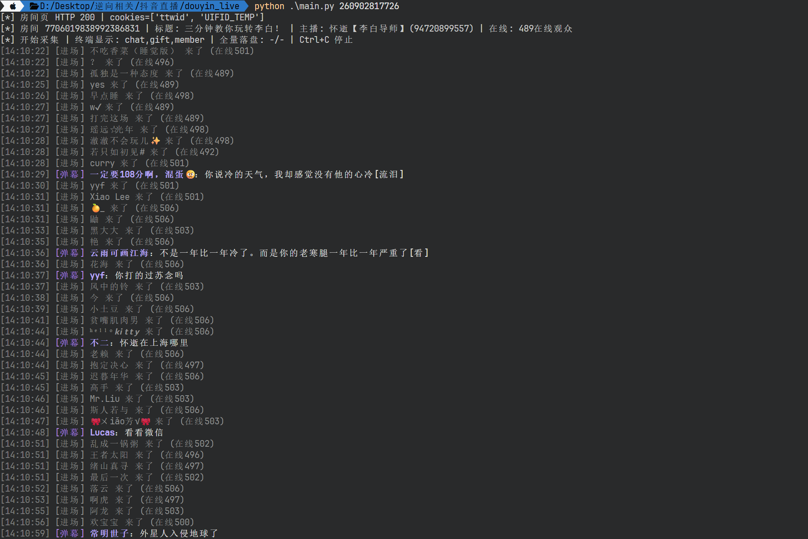

# DYDM · 抖音直播弹幕采集（纯协议）

不启动浏览器、不注入 JS、不调签名算法。只用 HTTP 请求走完 **房间页握手 → 房间信息 → `im/fetch` 长轮询 → protobuf 解包**，
实时拿到直播间的 **弹幕 / 礼物 / 进场 / 点赞 / 互动 / 人气**。

- 纯协议：只有 `requests` 一个网络依赖，protobuf 用手写的 wire 解析（不需要 `.proto` 编译）
- 终端按类别着色：弹幕青、礼物金、进场灰、点赞紫、互动蓝、人气绿
- 落盘：JSONL（全字段）+ CSV（Excel 可直接打开）
- 自带自检与探测脚本，采不到时能自己定位原因

## 截图

### 终端实时输出

`uv run main.py <web_rid>` 的实时画面：弹幕（青）、礼物（金）、进场（灰）、点赞（紫）按类别着色，
行首是时间戳，进场行还带回当前在线人数。



---

还想补的截图放在 `static/`，命名建议见 [static/README.md](static/README.md)：

| 文件名 | 内容 | 放好后在下面加一行即可 |
| --- | --- | --- |
| `static/gift.png` | 礼物消息 / `gift_probe.py` 字段对照 | `` |
| `static/protocol.png` | `selfcheck.py` 分层输出 / 抓包 | `` |
| `static/csv.png` | JSONL / CSV 落盘结果 | `` |

## 目录结构

```
DYDM/
├── main.py           # 主入口：全量采集（弹幕/礼物/进场/点赞/互动/人气）
├── danmaku.py        # 精简入口：只输出弹幕
├── client.py         # 协议客户端：握手 / 房间信息 / im-fetch 长轮询 / 游标 / 去重
├── proto.py          # protobuf wire 解析 + 各消息结构解析
├── colors.py         # 终端配色（类别→颜色只在这一处）
├── utils.py          # 小工具（越界时间戳兜底等）
├── selfcheck.py      # 在线自检：逐层打印链路状态
├── gift_probe.py     # 礼物字段探测：自动挑在播房间，抓到礼物就打印真实字段号
├── smoketest.py      # 离线自测：输出/落盘/管道/解析
├── pyproject.toml    # uv 依赖声明
├── uv.lock           # uv 锁文件
├── requirements.txt  # pip 用户的等价依赖
├── static/           # 截图目录
└── data/             # 输出目录（jsonl / csv / 探测日志）
```

## 安装（uv）

```bash
uv sync                 # 按 pyproject.toml + uv.lock 建环境
uv run main.py 343074527583
```

`brotli` 是硬依赖：服务端对 `/webcast/*` 常返回 `Content-Encoding: br`，
缺了它在「房间信息」这一步就会失败（表现为乱码或 JSON 解析错误）。用 uv 不用手动装。

不想用 uv：

```bash
pip install -r requirements.txt
python main.py 343074527583
```

## 用法

### 主入口 `main.py`

```bash
uv run main.py 343074527583                        # 终端: 弹幕+礼物+进场
uv run main.py 343074527583 --types all            # 终端: 全部类别
uv run main.py 343074527583 --gift-only            # 只看礼物
uv run main.py 343074527583 --only chat,gift       # 只看弹幕和礼物
uv run main.py 343074527583 --avatar               # 消息行附头像 URL(缩短)
uv run main.py 343074527583 --seconds 600 \
     --jsonl data/room.jsonl --csv data/room.csv   # 全量落盘
uv run main.py "https://live.douyin.com/343074527583?room_id=xxx"
```

| 选项 | 说明 |
| --- | --- |
| `--types` | 终端显示哪些类别，`all` = 全部（默认 `chat,gift,member`） |
| `--only` / `--gift-only` / `--chat-only` | 显示类别的快捷写法 |
| `--avatar` | 行尾附头像 URL（缩短为 `文件名~c5_100x100.jpeg`）；完整 URL 始终在 JSONL/CSV 中 |
| `--plain` | 弹幕只输出正文（管道友好，不带颜色） |
| `--jsonl` / `--csv` | 全量落盘（JSONL 全字段；CSV 可直接 Excel 打开） |
| `--seconds` | 采集 N 秒后退出，0 = 一直跑 |
| `--stats-every` | 每 N 秒在 stderr 打统计（默认 60，0 关闭） |
| `--no-color` | 关闭彩色输出（管道/重定向时自动关闭；也认 `NO_COLOR`） |
| `--quiet` | 不打印，只落盘 |

终端样例（实际是彩色的，下面是去色版）：

```
[14:11:37] [进场] V🎱✈️ 来了
[14:11:46] [弹幕] V🎱✈️：我的给修好了
[14:11:51] [进场] a 烨飞防、吊运 来了 (在线1)
[14:12:01] [弹幕] V🎱✈️：70p
[14:12:13] [弹幕] V🎱✈️：火花塞喷出来那个
[14:12:20] [礼物] 粉丝A 送出 小心心 x5 连击x3
```

### 精简入口 `danmaku.py`

```bash
uv run danmaku.py 343074527583        # 只输出弹幕
uv run danmaku.py 343074527583 --plain
```

### 自检与探测

```bash
uv run selfcheck.py 343074527583      # 在线自检（需房间在播）
uv run smoketest.py                   # 离线自测，不联网
uv run gift_probe.py                  # 自动挑在播房间，抓到礼物就打印字段对照
uv run gift_probe.py <web_rid> --rounds 60
```

## 协议链路

1. `GET https://live.douyin.com/{web_rid}` → 拿 `ttwid` cookie（必须，否则容易被风控）
2. `GET /webcast/room/web/enter/?web_rid={web_rid}&aid=6383&...` → JSON，取
   `data.data[0].id_str`（真实 room_id）与 `data.user.id_str`（主播 uid）
3. `POST /webcast/im/fetch/?aid=6383&resp_content_type=protobuf&...`，form body 关键字段：

   | 字段 | 说明 |
   | --- | --- |
   | `cursor` | 首轮 `t-<毫秒时间戳>`，之后用响应里的 cursor 原样回传 |
   | `room_id` | 第 2 步拿到的 room_id |
   | `user_unique_id` | 主播 uid |
   | `ttwid` | cookie 里的 ttwid |
   | `internal_ext` | 响应回传的扩展串（首轮为空） |
   | `identity=audience`、`endpoint=live_pc` | 以观众身份接入 |
   | `version_code=180800` | 配合 query 里的 `webcast_sdk_version` |

4. 响应是 protobuf（`application/protobuffer`，可能 gzip/br 压缩）：

   ```
   WebcastResponse
   ├─ 1: repeated Message
   │    ├─ 1: method          (WebcastChatMessage / WebcastGiftMessage / ...)
   │    ├─ 2: payload         (各消息自己的结构)
   │    └─ 3: msg_id
   ├─ 2: cursor               下一轮回传
   ├─ 3: fetch_interval(ms)   建议轮询间隔
   ├─ 5: internal_ext         下一轮回传
   └─ 9: need_ack
   ```

5. 各类消息 payload（均已用真实抓包核对）：

   | 消息 | 关键字段 |
   | --- | --- |
   | `WebcastChatMessage`（弹幕） | `2`=User，`3`=弹幕文本，`4`=原始文本 |
   | `WebcastGiftMessage`（礼物） | `2`=gift_id，`5`=combo_count，`6`=repeat_count，`7`=User，`15`=GiftStruct（`16`=礼物名），`18`=total_count |
   | `WebcastMemberMessage`（进场） | `2`=User，`3`=当前在线人数 |
   | `WebcastLikeMessage`（点赞） | `2`=本次点赞数，`3`=累计，`5`=User |
   | `WebcastSocialMessage`（关注/分享） | `2`=User，`5`=action |
   | `WebcastRoomStatsMessage`（人气） | `3`/`5`=人数，`4`=展示串 |
   | User | `1`/`1028`=打码 uid，`3`=昵称，`9`=头像（`9.1`=URL 列表），`46`=sec_uid，`73`=真实 uid |

   礼物字段若某次对不上，记录里会留 `gift_unknown_fields` / `gift_unknown_texts`
   （该条礼物的全部数字字段与短文本），便于离线修正映射。

## 字段说明

```json
{"method":"WebcastChatMessage","kind":"chat","msg_id":"7706043262293648683",
 "room_id":"7706036911999060751","create_time":1794203020000,
 "user":"V🎱✈️","uid":"108325263804","level":16,"sec_uid":"MS4wLjAB...",
 "avatar":"https://p11-webcast.douyinpic.com/img/webcast/xxx.jpeg",
 "content":"我的给修好了","seq":32,"recv_at":1794203020197}
```

- **头像**：`avatar` 是原始 URL，可自行拼缩放后缀（如 `~c5_100x100.jpeg`）；`avatar_uri` 是 CDN 相对路径
- 非登录态下，抖音对部分观众昵称/uid 打码（`贝***`、uid 常为 `111111`）；人气较高的房间通常是明文昵称
- `kind` 取值：`chat` / `gift` / `member` / `like` / `social` / `stats` / `control` / `fansclub` / `other`

## 常见问题

| 现象 | 原因 / 处理 |
| --- | --- |
| `room/enter` 乱码、JSON 解析失败 | 缺 `brotli`，`uv sync` 或 `pip install brotli` |
| 能拿到房间信息，但长时间没有弹幕 | 房间 `status != 2`（未开播/已结束）或该时段确实没人发言，跑 `selfcheck.py` 看消息类别分布 |
| 昵称全是 `xx***` | 游客态被打码，与脚本无关 |
| 终端出现 `?[36m` 之类字符 | 控制台不支持 ANSI，加 `--no-color` |
| 落盘文件只有 1 条就断了 | 已被修复：管道被 `head`/`Select-Object` 提前关闭时不再中断采集 |

## 说明

- 同一批消息服务端会重复推送，脚本按 `msg_id` 去重
- 轮询间隔跟随服务端下发的 `fetch_interval`（默认 1000ms），不会高频轰炸
- 终端输出被 `| head`、`| Select-Object -First N`、`> $null` 提前关闭时不会中断采集，只停止上屏，文件照常写
- 长跑建议加 `--jsonl`；中断后游标不续传，重启会重新拉当前可见的历史消息
- 仅用于协议学习与自有直播间数据统计；需要登录可见的内容（付费直播等）不在游客态覆盖范围内

## 致谢

感谢 [Linux.do 社区](https://linux.do) 的交流与支持。

[](https://linux.do)
